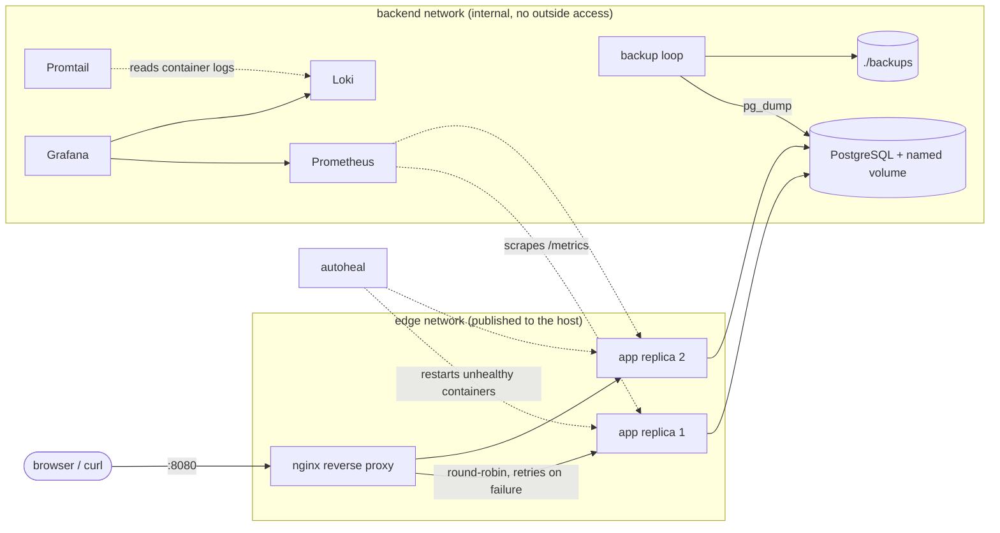

# It Works On My Machine

A small web service (a notes API on Postgres) plus the deployment around it, built so that
anyone can clone the repo, run **two commands** and get the same working system, and so that
crashes, bad releases and data loss are things the setup recovers from instead of things
somebody has to remember how to fix.

```bash
cp .env.example .env      # then change the two passwords
make up                   # build, start, wait until everything is healthy
```

App: <http://localhost:8080> · Grafana: <http://localhost:3000> (admin / your `GRAFANA_PASSWORD`) · Prometheus: <http://localhost:9090>

## Architecture



| Service | Job |
|---|---|
| `proxy` (nginx) | Only public entry point. Spreads requests over the replicas, retries on another replica if one fails, blocks `/admin/` and `/metrics` from outside. |
| `app` x2 | Flask + gunicorn. `/healthz` (liveness), `/readyz` (can reach DB), `/metrics`, JSON logs. |
| `db` (Postgres 16) | Data lives in the `pgdata` volume, so recreating the container loses nothing. |
| `autoheal` | Docker only *labels* a container unhealthy; this restarts it. |
| `backup` | Hourly `pg_dump` into `./backups`, keeps the newest 7. |
| `prometheus`, `grafana`, `loki`, `promtail` | Metrics, dashboard (pre-provisioned), centralized logs. Started by `COMPOSE_PROFILES=monitoring`. |

## Why this fixes the "works on my machine" story

| Problem in the task | What prevents it here |
|---|---|
| "Database connection is misconfigured" | One `.env`; compose builds the connection string itself. The DB starts first (`depends_on: service_healthy`). |
| "Environment variables are missing" | Compose refuses to start with a message like `POSTGRES_PASSWORD is missing a value: set POSTGRES_PASSWORD in .env`. The app also stops with `DATABASE_URL is not set. Copy .env.example to .env`. |
| "Nobody remembers the startup commands" | `make up`, `make down`, `make deploy`, `make backup`, `make restore`. `make help`-style comments are in the Makefile. |
| "Then the server crashes" | `restart: unless-stopped`, health checks + autoheal, two replicas behind nginx, so one replica dying is invisible to users. |

## Everyday commands

```bash
make up          # start everything
make ps          # status and health
make logs        # follow all logs
make down        # stop (data is kept)
make clean       # stop AND delete all data (asks no questions)
make test        # unit tests
```

Logs and metrics: app and nginx write one JSON object per line to stdout, Promtail ships them to
Loki, and Grafana's "It Works On My Machine - overview" dashboard shows healthy replicas,
requests/s by status, p95 latency, DB errors and a live log panel. Prometheus has alert rules
(`prometheus/alerts.yml`) for a replica down, fewer than 2 replicas, >5% errors and DB errors;
they are visible in the Prometheus UI (no notification channel is wired up).

## Updating the application (minimal downtime)

**Automatic:** `.github/workflows/ci-cd.yml` runs on every push.

1. `test`: ruff + pytest.
2. `smoke`: starts the real stack (nginx, replicas, Postgres) and checks it with curl.
3. `publish` (main only): builds the image and pushes `ghcr.io/<repo>-app:<git-sha>` and `:latest`.
4. `deploy` (optional): if you set the repo variable `DEPLOY_HOST` and secrets `DEPLOY_USER` / `DEPLOY_SSH_KEY`, it SSHes to the server and runs `scripts/deploy.sh <sha>`.

**Manual:** `make deploy TAG=v2` (or `scripts/deploy.sh v2`). It does a rolling update:

1. start new replicas next to the old ones,
2. wait until every new one is **healthy**,
3. only then stop the old ones (SIGTERM, so in-flight requests finish).

If the new version never becomes healthy within 90 s, the new containers are removed, the old
ones keep serving, and the script exits non-zero. **Rollback** of a release that was healthy but
wrong is just deploying the previous tag (`.deploy-history` lists them): `make deploy TAG=<old>`.

On a server, set `APP_IMAGE=ghcr.io/<owner>/<repo>-app` in `.env` (and `docker login ghcr.io`
if the package is private) so `deploy.sh` pulls from the registry instead of building.

## Failure scenarios

`make demo-crash` runs all three while sending steady traffic through nginx, and prints how long
recovery took and how many requests got each HTTP status. (It needs `ENABLE_CHAOS=true`, the
default in `.env.example`; keep it `false` anywhere real. The `/admin/*` switches are also
blocked by nginx from the outside.)

| # | What breaks | What should happen |
|---|---|---|
| 1 | The server process in one replica is killed (like an OOM kill) | The container exits, Docker's restart policy starts it again, nginx retries failed requests on the other replica, so users should see (almost) no errors. |
| 2 | One replica stays alive but `/healthz` returns 500 | After 3 failed checks (about 15 s) the container is marked unhealthy and `autoheal` restarts it. |
| 3 | The database container is killed | `/readyz` and `/notes` return a clean `503`; Docker restarts Postgres; replicas reconnect on their own **without** being restarted (`/healthz` does not depend on the DB, on purpose); data is still there. |

### Demo results (fill this in from your own machine)

Run `make up && make demo-crash` and paste the output here. Look at the lines
`t+NNs health=... (restarted)` for recovery time and the status-code counts at the end.

```
(paste your output here)
```

## Backups and restore

* The `backup` service writes `backups/db-<UTC timestamp>.dump` every `BACKUP_INTERVAL_SECONDS`
  (default hourly) and keeps `BACKUP_KEEP` (default 7). Dumps are written to a temp name and
  renamed, so a half-written file is never mistaken for a backup.
* `make backup` takes one right now. `make restore` restores the newest dump; `make restore FILE=backups/db-....dump` a specific one. Restore stops the app, runs `pg_restore --clean --if-exists`, and starts it again.
* `make demo-backup` shows the whole cycle: add data, back up, `DROP TABLE`, restore, verify.

## Recovery runbook

| Symptom | Check | Fix |
|---|---|---|
| Site down | `make ps`, `make logs` | `make up` (idempotent) |
| A replica keeps restarting | `docker compose logs app` | Fix the cause; or roll back with `make deploy TAG=<previous>` |
| Bad release | `.deploy-history` | `make deploy TAG=<previous>` |
| Data deleted/corrupted | `ls backups/` | `make restore` |
| Whole host lost | repo + latest dump from `backups/` (copy these off the machine!) | clone, `cp .env.example .env`, `make up`, `make restore FILE=...` |
| "variable is missing" on start | the message names the variable | add it to `.env` |

## Design decisions

* **Compose, not Kubernetes.** Everything runs on one laptop or VM with one command. K8s would add moving parts without improving what this task grades (repeatability and recovery).
* **`/healthz` ignores the database, `/readyz` checks it.** If Docker restarted every replica whenever Postgres hiccupped, a 5-second DB blip would become a full outage.
* **One gunicorn worker per container (8 threads), scale with replicas.** Prometheus metrics live in process memory; one process per container keeps them correct.
* **Rolling update with compose only** (`--scale` + health wait) instead of Swarm/K8s, so there is nothing extra to install.
* **Private `backend` network.** Postgres, Prometheus and Loki are not reachable from outside the compose project.
* **Pinned image versions**, so a rebuild next month is the same system.

## Test status

* Unit tests (`make test`, 13 tests): endpoints, validation, DB-outage behaviour, chaos switches. A fake DB is used, so they run anywhere.
* Checked against a real PostgreSQL 16 running **outside Docker**: two replicas starting at the same time on an empty DB (schema race), shared counter, notes written on one replica and read on the other, `/healthz` vs `/readyz` during a DB outage, automatic reconnect, the crash switch actually killing the server process, `backup.sh` (including retention and cleanup after a failed dump) and `pg_restore` bringing a dropped table back.
* Configuration checks: `docker compose config` accepts the compose file (with and without the monitoring profile) and rejects a missing password with a clear message; all YAML/JSON and shell scripts parse.
* **Not yet run end to end inside Docker:** the images, nginx proxying and retry behaviour, autoheal, Prometheus/Grafana/Loki wiring, `deploy.sh`, and the three demo scripts. The CI `smoke` job exercises the core stack on every push, and `make demo-crash` is how you verify the rest locally.

## Limitations and what I would do next

* Single host: if the machine dies, everything is down until restored (backups are local files; copy them off-host).
* The backup is `pg_dump` every hour, so up to an hour of data can be lost. Continuous archiving (WAL) would shrink that.
* HTTP only. Adding Caddy or Traefik in front for automatic HTTPS is the natural next step.
* `autoheal` and `promtail` mount the Docker socket, which is powerful; fine for a single-tenant host, worth hardening otherwise.
* Alerts are visible in Prometheus but nothing sends a notification (no Alertmanager).
* A new connection per request is the first bottleneck I would expect under load (add a pool such as PgBouncer or `psycopg_pool`); no load test was run.
* Not done: Terraform/OpenTofu, Kubernetes manifests, autoscaling.

## Layout

```
app/                  Flask service, Dockerfile, unit tests
nginx/nginx.conf      reverse proxy, JSON access log, retry rules
docker-compose.yml    all services, networks, volumes, health checks
.env.example          every setting, with comments
prometheus/ grafana/ loki/   metrics, dashboard, log shipping
scripts/              deploy.sh, backup.sh, restore.sh, demo-crash.sh, demo-backup-restore.sh
.github/workflows/    CI/CD pipeline
Makefile              the commands you actually type
```
